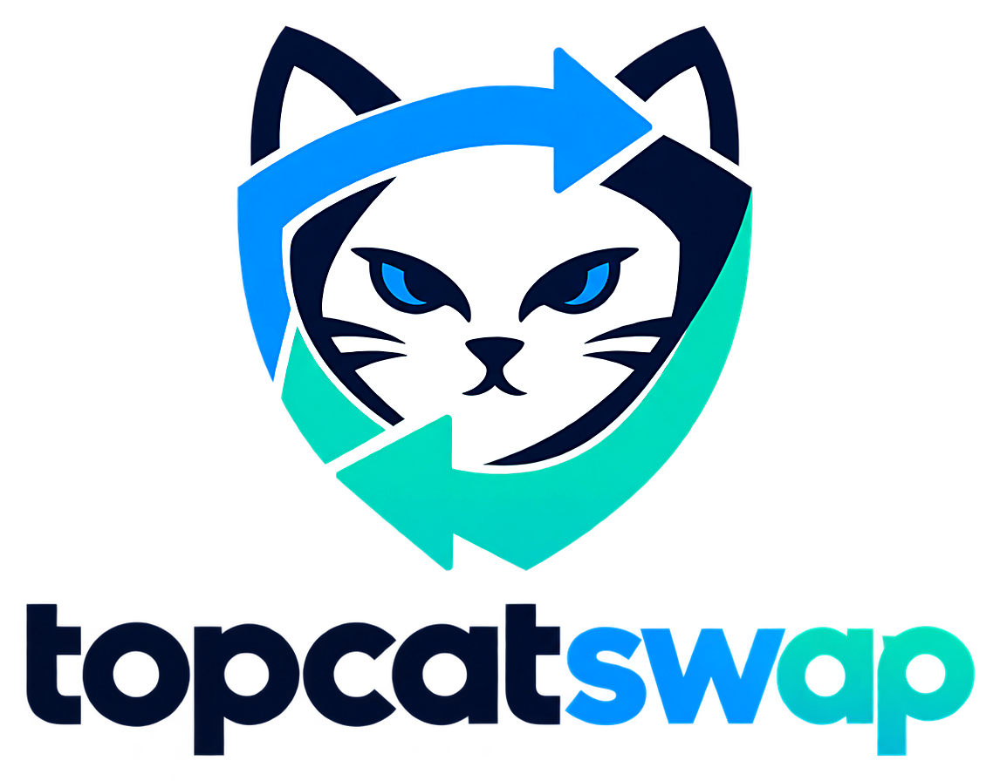

<p align="center"></p>

# TopCatSwap

**Swaps na Uniswap V2, V3 e V4 com proteção contra sandwich, bundles privados e carteira à tua escolha. Código aberto, sem servidor, sem backdoors.**

*[English](README.md) · Português*

**Site:** https://topcatmasterinvestor.github.io/topcatswap/

O TopCatSwap compara as pools V2, V3 e V4 da Uniswap para o par que escolhes, mostra quanto recebes em cada uma e faz o swap na melhor, assinado pela tua carteira. As chaves nunca saem da carteira e não há nenhum servidor do TopCatSwap no meio: o código fala diretamente com a blockchain (RPC) e com a tua carteira.

| | Web | App Ubuntu | Linha de comandos |
|---|---|---|---|
| Swap (V2/V3/V4), Pools, Carteiras | ✓ | ✓ | ✓ |
| Bundles (tudo-ou-nada, privados) | ✓ (com relay) | ✓ | — |
| Ledger | ✓ USB: Chrome/Edge/Brave · Bluetooth: Android (Nano X, Stax, Flex) | ✓ USB | ✓ USB |
| Trezor | ✓ Trezor Connect | ✓ (experimental) | — |
| MetaMask, OKX, Rabby, Coinbase Wallet, Trust Wallet | ✓ direto | ✓ por página local | — |
| Carteiras importadas (até 5, cifradas) | ✓ no navegador | ✓ no computador | ✓ |
| Português (PT) e English (US) | ✓ | ✓ | ✓ |

Redes: Ethereum, Arbitrum One e BNB Smart Chain.

## Como usar

### Versão web

Abre o site publicado (GitHub Pages deste repositório) ou corre-o no teu computador:

```bash
node tools/build-web.js          # gera dist-web/ (não precisa de npm install)
python3 -m http.server 8080 -d dist-web
# abre http://localhost:8080
```

- **Ledger** precisa de Chrome, Edge, Brave ou Opera (WebHID) num endereço `https://` ou `localhost`. No Linux, as regras udev da Ledger.
- **Bundles** precisam de um *relay* porque os builders não aceitam pedidos de sites (CORS). Ver [relay/](#relay-dos-bundles).
- **Telemóvel e tablet** (iPhone, iPad, Android; Chrome, Brave, Firefox, Safari):
  - O ecrã adapta-se: navegação em baixo e uma só coluna.
  - As carteiras de hardware só aparecem se o navegador as conseguir usar. No Android (Chrome, Edge ou Brave) dá para usar a Ledger Nano X, Stax ou Flex por Bluetooth (experimental). O iPhone e o Firefox não têm Bluetooth para sites.
  - MetaMask, Trust, OKX e Coinbase: abre o site dentro da app da carteira (há um link para cada uma) ou usa uma carteira importada.
- As definições e as carteiras importadas ficam no `localStorage` do teu navegador, neste site. Nada é enviado para servidores do TopCatSwap (não existem).

### App para Ubuntu

```bash
cd desktop
./build-ubuntu.sh
sudo apt install ./dist/TopCatSwap-1.1.2-amd64.deb
```

Instruções completas: [desktop/COMO-INSTALAR-UBUNTU.txt](desktop/COMO-INSTALAR-UBUNTU.txt) e os PDFs em [docs/](docs/) (guias em inglês e tutoriais em português).

### Linha de comandos

```bash
cd desktop && npm install ethers @ledgerhq/hw-transport-node-hid @ledgerhq/hw-app-eth
node engine/topcatswap.js HELP        # português
node engine/topcatswap.en.js HELP     # English
```

## Segurança

Lê o [SECURITY.md](SECURITY.md): onde ficam as chaves, para onde a app comunica, como confirmar que o que corres é igual a este código e como reportar problemas.

Resumo:

- **Ledger e Trezor**: a chave nunca sai do dispositivo; confirmas cada transação no ecrã dele.
- **Extensões** (MetaMask, …): a chave fica na extensão; confirmas lá.
- **Carteiras importadas**: a chave fica cifrada (keystore padrão da Ethereum, scrypt + AES) com uma password só dessa carteira, no teu computador ou navegador. É menos segura do que uma carteira de hardware.
- **Sem telemetria, sem servidor próprio, sem chaves de API escondidas.**

## Relay dos bundles

Os builders (Flashbots, BuilderNet, Titan, beaverbuild, 48 Club, BlockRazor) não respondem a pedidos vindos de páginas web. A pasta [relay/](relay/) tem um reencaminhador mínimo, com **lista fechada de destinos** ([relay/allowlist.mjs](relay/allowlist.mjs)), que só recebe bundles **já assinados**:

```bash
# Cloudflare Workers (conta gratuita)
cd relay && npx wrangler deploy
# ou no teu computador
node relay/server.mjs      # http://127.0.0.1:8787
```

Depois põe o endereço do relay em **Definições › Ligações › Relay dos bundles** (ou em `web-src/config.js` antes do build, para todos os utilizadores do teu site). A app de secretária não precisa de relay.

## Publicar no GitHub

1. Cria um repositório e envia este código (`git push`).
2. Em **Settings › Pages**, escolhe **Source: GitHub Actions**. O workflow [pages.yml](.github/workflows/pages.yml) gera e publica o site a cada push na `main`.
3. Para lançar uma versão da app Ubuntu: `git tag v1.1.2 && git push --tags`. O workflow [release.yml](.github/workflows/release.yml) gera o `.deb` e o `.AppImage` e publica-os com os `SHA256SUMS`.

## Estrutura

```
desktop/            app Electron (Ubuntu) e motor partilhado
  engine/           motor: cotações, swaps, bundles, carteiras (*.en.js = inglês)
  renderer/         interface
web-src/            o que muda no navegador: shims, Ledger WebHID, extensões, window.api
tools/build-web.js  gera dist-web/ a partir de desktop/ + web-src/
tools/i18n/         gera os ficheiros *.en.js a partir dos portugueses
relay/              relay dos bundles (Cloudflare Worker ou Node)
tests/              testes sem rede (relay, Ledger simulada, fluxo de bundles)
docs/               tutoriais em PDF
```

A versão web usa **o mesmo motor** da app de secretária: só os acessos ao sistema (USB, ficheiros, rede local) são substituídos por equivalentes do navegador.

## Desenvolvimento

```bash
node tools/build-web.js
node tests/relay.test.mjs
npm install --no-save --prefix .ci ethers@6.13.4
NODE_PATH=.ci/node_modules node tests/ledger-webhid.test.js
NODE_PATH=.ci/node_modules node tests/ledger-ble.test.js
NODE_PATH=.ci/node_modules node tests/bundles-flow.test.js
```

Textos: escreve em português nos ficheiros `*.js`; para regenerar o inglês, `cd tools/i18n && python3 build_en.py ../../desktop` (novas frases: acrescenta a `en4.tsv`).

## Aviso

Software experimental, sem garantias (licença [MIT](LICENSE)). Swaps em DeFi envolvem risco de perda. Começa com valores pequenos. Isto não é aconselhamento financeiro.
